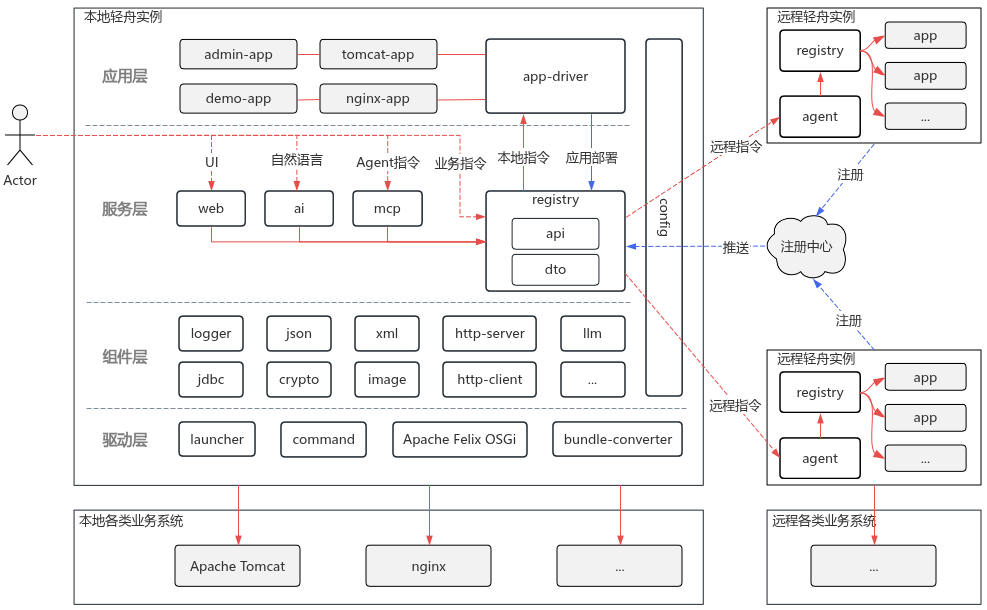

# Qingzhou（轻舟）轻量级智能管理开发平台

## 概述

Qingzhou（轻舟）是基于 Java 的轻量级管理平台，用于对多品类异构业务系统做统一纳管与智能运维。
开发者只需编写模型类并添加注解，平台即自动生成列表、表单、操作按钮，以及 REST 与 MCP 两种接口，无需手写前端与接口层。
平台以「轻舟应用」插件承载具体纳管逻辑，通过网络 Agent 纳管多台主机，并支持大模型驱动的自然语言运维。

### 架构



管控台通过内置注册中心纳管各主机上的 Agent；Agent 所在实例加载轻舟应用插件，由插件完成对目标系统的具体操作。

## 核心能力

| 能力 | 说明 |
| --- | --- |
| 模型驱动 | 一个 `ModelBase` 子类加 `@Model`/`@ModelField`/`@ModelAction` 注解，自动生成列表、表单、按钮与接口 |
| 插件化 | 新增纳管对象只需开发一个轻舟应用 jar，投入 `instances/<实例>/apps` 并重启，不改动框架 |
| 自动发现 | 应用可在 `MANIFEST.MF` 声明 `Qingzhou-Detection-*` 探测规则，发现目标软件后自动完成自部署 |
| 集中纳管 | 中心实例内置注册中心，Agent 心跳自注册，支持跨主机统一纳管与跨节点调用 |
| AI 赋能 | 接入兼容 OpenAI 的模型后，按技能编排调用平台模型操作，内置健康检查等技能；同时以 MCP 对外提供工具调用 |
| 双协议输出 | 同一业务模型同时输出 REST 与 MCP，兼顾人工操作界面与 AI 工具调用 |
| 可观测 | `field_type = monitor, numeric = true` 的字段自动成为 Prometheus 指标，内置 `/monitor/prometheus` 抓取端点与自监控指标 |
| 安全 | 登录态、TOTP、OAuth2 单点登录、登录失败锁定、域密钥链路加密、CSP/HSTS |

## 内置应用

产品包自带以下应用（位于 `instances/default/apps`），可直接作为开发模板：

| 应用 | 纳管对象 | 能力 |
| --- | --- | --- |
| Redis 管理 | Redis | 单机/哨兵/集群日常运维 |
| Tomcat 管理 | Tomcat | 连接器配置、应用部署、线程池监控、日志查看 |
| Nacos 应用 | Nacos | 配置中心与服务注册发现 |
| ZooKeeper 应用 | ZooKeeper | 服务状态、连接、生效参数查看 |
| OAuth2 授权服务 | — | 授权码、密码、客户端凭证、刷新令牌 |
| 示例应用 | — | 演示标准开发方式 |

## 适用场景

轻舟不用于开发交易、订单等业务生产系统，而是开发**管理业务系统的系统**：

| 类型 | 典型场景 | 契合点 |
| --- | --- | --- |
| 统一 IT 运维管控 | 多云管理、混合云监控、自动化运维 | Agent 跨网络自注册，集中监控与批量操作 |
| 异构系统聚合门户 | 整合 ERP/CRM/OA 的统一门户、跨系统看板 | 插件适配异构底层，统一模型屏蔽差异 |
| 物联网与边缘管理 | 边缘网关管控台、分布式设备监控 | Agent 契合边缘接入，插件承载私有协议 |
| 安全与合规审计 | 统一权限治理、全局策略巡检下发 | 集中下发与审计，标准化接口便于跨系统比对 |
| 意图驱动智能运营 | AIOps 助手、自然语言配置中心 | 大模型把跨系统巡检操作转为自然语言指令 |

## 快速上手

1. **环境**：JDK 8+、Maven 3.8+（建议版本，构建未强制校验）。
2. **构建**：源码根目录执行 `mvn clean install -DskipTests`，产物为 `qingzhou/target/qingzhou`。对外发布加 `-Prelease`；默认的开发档 zip 名带构建时间戳。
3. **初始化**：`cd qingzhou/target/qingzhou && sh bin/init.sh`，按提示设置全局密钥、管理员口令，可选 TOTP、TLS 证书、Agent 域密钥。未初始化直接启动会因缺少必需配置退出。
4. **启动**：`sh bin/start.sh`，可追加实例名（默认 `default`）。
5. **访问**：`http://localhost:7900/web`，账号 `admin`，口令为初始化时设置；若初始化时启用了 TLS，改用 `https://`。

### 目录结构

```text
qingzhou/
├── bin/
│   ├── start.sh                  # 启动，可追加实例名
│   ├── init.sh                   # 交互式安全初始化，可追加实例名
│   ├── encrypt.sh                # 用实例全局密钥加密明文口令
│   ├── digest.sh                 # 生成管理员登录口令摘要
│   ├── token.sh                  # 生成访问系统的令牌
│   ├── qingzhou-launcher.jar     # 启动引导
│   └── win/
│       ├── start.bat
│       ├── init.bat
│       ├── token.bat
│       ├── digest.bat
│       └── encrypt.bat
├── instances/
│   └── default/                  # 一个实例，配置、应用、数据、日志相互隔离
│       ├── conf/                 # qingzhou.properties、secret-key.properties、mcp.json
│       ├── apps/                 # 轻舟应用（插件）投放目录
│       └── data/ logs/ temp/     # 运行期生成
└── lib/
    └── version<版本>.zip         # 平台 jar，首次启动若解压目录不存在则自动解压
```

- `init.sh`、`encrypt.sh` 需在可交互终端执行。`sh bin/encrypt.sh default` 读取明文口令并输出密文，可直接写入配置项。
- `lib` 下多版本并存时取版本号最大的目录；升级只需放入新的 `version*.zip` 后重启。解压后的 zip 可保留或删除。

### 多实例

`instances` 下每个子目录即一个独立实例。复制 `default` 为新目录（如 `instances/agent`）后，执行 `sh bin/init.sh agent` 完成初始化，`sh bin/start.sh agent` 启动。
同机多实例须在各自 `conf/qingzhou.properties` 中配置不同的 `qingzhou-http-server.port`。

## 远程管理

远程管理基于「注册中心 + Agent」模型，实现跨主机统一纳管与跨节点应用调用。

- **注册中心**：正常运行的轻舟实例，内置 registry 服务，接收 Agent 心跳、维护远程实例清单并在管控台呈现。
- **Agent**：被纳管主机上的另一个轻舟实例，按心跳周期自动注册，并暴露本机应用供中心跨节点调用。

### 一、准备注册中心

1. 按「快速上手」构建、初始化并启动一个实例作为注册中心。
2. 跨主机纳管须改监听地址：`qingzhou-http-server.host=0.0.0.0`。默认 `127.0.0.1` 仅本机可达，其他主机无法访问管控台，Agent 也无法回连。
3. 在 `instances/default/conf/qingzhou.properties` 按需调整：
    - `qingzhou-registry.interval`：检测远端实例状态的周期（秒，默认 6）。
    - `qingzhou-registry.timeout`：远端实例失联判定阈值（秒，默认 12，须明显大于 Agent 心跳周期）。
    - `qingzhou-registry.trust_advertised_host`：反代/NAT 下是否采信 Agent 自报地址（默认 false，风险见「安全边界」）。

### 二、部署 Agent

关键是与中心**共享同一条域根密钥**：

1. 在被纳管主机解压同一份产品包，实例可用自带的 `default`，也可复制独立实例目录（如 `instances/agent`）。
2. 在 `instances/default/conf/secret-key.properties` 配置与中心**完全相同**的域根密钥（带外分发，切勿经网络传输）：
    ```properties
    agent-domain~default=<Base64 编码密钥>
    ```
    > 格式为 `agent-domain~<域名>`，域名是中心与一组 Agent 共享的信任域标识，一个域可纳管多个实例，两端须同名同值。声明了 `qingzhou-agent.url` 却缺少域根密钥时，实例启动即失败。
3. 在 `instances/default/conf/qingzhou.properties` 启用并指向中心：
    ```properties
    qingzhou-agent.url=https://<中心地址>:7900
    qingzhou-agent.interval=6
    # qingzhou-agent.advertised_host=反代/NAT 下本机对外可达地址；留空由中心按连接源地址推断
    ```
    `qingzhou-agent.url` 会自动拼接 `/registry/register` 作为注册接口，启用 Agent 时必填；协议须与中心一致，中心未启用 TLS 时用 `http://`。
4. 启动：`sh bin/start.sh agent`，Agent 即按 `interval` 周期心跳注册。

### 三、验证与使用

- Agent 日志首次注册成功会打印 `N apps registered`；续期不打印，应用数为 0 时同样打印，需结合下一步确认。
- 访问中心管控台，实例列表除本机（host 为 `localhost`，实例 ID 为 `-`）外会列出已纳管的远程实例（host/port/version），以此为准。
- 选中远程实例即可跨节点调用其应用；文件类参数由中心分片加密上传至 Agent 执行。

### 安全边界

- 域根密钥仅存于中心与 Agent 两侧的 `secret-key.properties`，属带外分发的信任根；链路报文用域密钥加每实例密钥加密，同域其他节点无法冒名续期或解密。
- `qingzhou-http-client.allow_ssl_trust_all=true` 会跳过自签证书校验，链路可被中间人攻击，仅限受控内网。
- `trust_advertised_host` 仅在跨网络/NAT 部署时开启：开启后持域密钥者可将中心流量导向任意内网地址（SSRF 风险）。

## 接口与集成

默认监听 7900，接口与认证方式如下：

| 用途 | 方法与路径 | 认证 |
| --- | --- | --- |
| 管控台页面 | `/web` | 静态资源免认证 |
| 管控台数据接口 | `/registry/app/*`、`/registry/instance` | 登录态 |
| REST 集成 | `/registry/invoke/<实例>/<应用>/<模型>/<操作>[/<id>]` | 登录态 |
| MCP | `/ai/mcp` | 登录态 |
| 监控指标 | `/monitor/prometheus` | 登录态 / Bearer 令牌 |
| 登录与 OAuth2 | `/auth/*`、`/oauth2/*` | 免认证（登录入口） |
| Agent 链路 | `/registry/register`、`/agent/invoke`、`/agent/upload` | 免登录，域密钥加密保护 |

## 更多信息

### 参数配置

配置文件位于 `产品包/instances/<实例>/conf/qingzhou.properties`，修改后重启实例生效。

### 前后端分离

前端静态资源位于 `modules/qingzhou-web/src/main/resources/webapp`，可单独部署到 Nginx；后端接口按下列前缀反向代理：

```nginx
server {
    listen 8000;

    location /web {
        alias <前端资源目录>;
        index index.html;
        try_files $uri $uri/ /web/index.html;
    }

    location ^~ /registry/ { proxy_pass http://localhost:7900/registry/; }
    location ^~ /ai/       { proxy_pass http://localhost:7900/ai/; }
    location ^~ /auth/     { proxy_pass http://localhost:7900/auth/; }
    location ^~ /oauth2/   { proxy_pass http://localhost:7900/oauth2/; }
    # 需要外部抓取监控指标时再开启
    # location ^~ /monitor/ { proxy_pass http://localhost:7900/monitor/; }
}
```

启动 Nginx 后访问 `http://localhost:8000/web`。

### 监控指标抓取

`/monitor/prometheus` 需登录态，与管控台接口共用令牌（Cookie 或 `Authorization: Bearer`）。外部探针须使用长期令牌：

```sh
sh bin/token.sh <实例>   # 交互输入账号口令，选择角色与有效天数（默认 30 天，最长 365 天）
```

令牌中的角色须与应用 `@App.roles` 匹配，否则该应用指标不会出现。外部抓取还需放开上方 Nginx 配置中的 `/monitor/` 反代。

```yaml
scrape_configs:
  - job_name: qingzhou
    metrics_path: /monitor/prometheus
    authorization:
      type: Bearer
      credentials: <bin/token.sh 生成的令牌>
    static_configs:
      - targets: ['<host>:7900']
```

### 应用开发

1. 开发规范见 [docs/轻舟应用开发规范.md](./docs/轻舟应用开发规范.md)，示例见 `apps/qingzhou-app-demo`。
2. 在应用模块下执行 `mvn clean install`。
3. 将生成的 jar 放入 `instances/<实例>/apps`，重启后在管控台可见。

### 常见问题

- 启动即退出并提示 `xxx is missing in ..., run bin/init.sh to initialize`：未完成安全初始化，执行 `sh bin/init.sh` 后重启。
- 提示 `!!! WARNING: no interactive terminal`：口令输入不隐藏、可能回显或被记录，`init.sh`、`encrypt.sh` 应在可交互终端中执行。
- 解压 `version*.zip` 失败：按日志提示手动解压到 `lib/version<版本>`，或删除该目录后重启触发自动解压。
- 远程实例不出现：确认中心已设 `qingzhou-http-server.host=0.0.0.0`、端口放通、`qingzhou-agent.url` 可达且协议与中心一致、两端域密钥同名同值。
- 启用 TLS 后浏览器或 Agent 报证书错误：为自签证书补充信任，或在受控内网设置 `qingzhou-http-client.allow_ssl_trust_all=true`。
