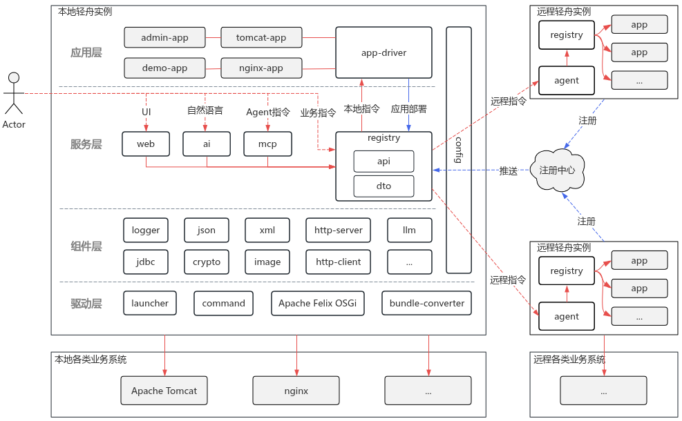

# Qingzhou（轻舟）轻量级智能管理开发平台

## 概述

Qingzhou（轻舟）是基于 Java 的轻量级管理平台，用于对多品类异构业务系统做统一纳管与智能运维。
开发者只需用注解定义模型、用能力接口声明所需操作，平台即自动呈现列表、表单与按钮，并把同一份模型能力经 REST 与 MCP 开放给管控台与 AI 工具，无需手写前端与接口层。
平台以「轻舟应用」插件承载具体纳管逻辑，通过网络 Agent 纳管多台主机，并支持大模型驱动的自然语言运维。

### 架构

管控台通过内置注册中心纳管各主机上的 Agent；Agent 所在实例加载轻舟应用插件，由插件完成对目标系统的具体操作。

## 核心能力

| 能力       | 说明                                                                                               |
|------------|----------------------------------------------------------------------------------------------------|
| 模型驱动   | 注解即元数据：声明模型、字段与能力接口，列表、表单、按钮与模型动作一次成型，零前端、零 Controller  |
| 插件化     | 纳管能力按应用 jar 独立交付、隔离装载，新增品类不改框架、不动存量应用                              |
| 自动发现   | 应用自带探测规则，发现目标软件即自动部署对应实例，无需人工登记纳管对象                             |
| 集中纳管   | 中心实例内置注册中心，Agent 心跳自注册，支持跨主机统一纳管与跨节点调用                             |
| AI 赋能    | 接入兼容 OpenAI 的模型后，按技能编排调用平台模型操作，内置健康检查等技能                           |
| 双协议输出 | REST 与 MCP 复用同一执行链路，管控台与 AI 调用无需二次适配                                         |
| 可观测     | 数值型监控字段自动暴露为 Prometheus 指标，观测能力与模型定义同源                                   |
| 安全       | 登录态、TOTP、OAuth2 单点登录、登录失败锁定、域密钥链路加密、CSP/HSTS                              |

## 内置应用

产品包自带以下应用（位于 `instances/default/apps`），可直接作为开发模板：

| 应用            | 纳管对象  | 能力                                       |
|-----------------|-----------|--------------------------------------------|
| Redis 管理      | Redis     | 单机/哨兵/集群日常运维                     |
| Tomcat 管理     | Tomcat    | 连接器配置、应用部署、线程池监控、日志查看 |
| Nacos 应用      | Nacos     | 配置中心与服务注册发现                     |
| ZooKeeper 应用  | ZooKeeper | 服务状态、连接、生效参数查看               |
| OAuth2 授权服务 | —         | 授权码、密码、客户端凭证、刷新令牌         |
| 示例应用        | —         | 演示标准开发方式                           |

## 适用场景

轻舟不用于开发交易、订单等业务生产系统，而是开发 **管理业务系统的系统**：

| 类型             | 典型场景                               | 契合点                                   |
|------------------|----------------------------------------|------------------------------------------|
| 统一 IT 运维管控 | 多云管理、混合云监控、自动化运维       | Agent 跨网络自注册，集中监控与批量操作   |
| 异构系统聚合门户 | 整合 ERP/CRM/OA 的统一门户、跨系统看板 | 插件适配异构底层，统一模型屏蔽差异       |
| 物联网与边缘管理 | 边缘网关管控台、分布式设备监控         | Agent 契合边缘接入，插件承载私有协议     |
| 安全与合规审计   | 统一权限治理、全局策略巡检下发         | 集中下发与审计，标准化接口便于跨系统比对 |
| 意图驱动智能运营 | AIOps 助手、自然语言配置中心           | 大模型把跨系统巡检操作转为自然语言指令   |

## 文档

本文只介绍产品定位与能力。部署、纳管、接口集成与排障见使用手册；配置项的含义、默认值与安全约束一律以 `*.readme` 为准。

- [使用手册](./docs/使用手册.md)：构建、初始化、部署、远程纳管、接口集成、排障
- [qingzhou.properties.readme](./docs/qingzhou.properties.readme)：全部配置项说明
- [secret-key.properties.readme](./docs/secret-key.properties.readme)：全局密钥与 Agent 域根密钥条目
- [mcp.json.readme](./docs/mcp.json.readme)：MCP 接入示例
- [轻舟应用开发规范](./docs/轻舟应用开发规范.md)：应用开发规范与示例

源码中这些文件位于 `docs/`，产品包中位于 `lib/version/docs/`（与本文同目录）。
